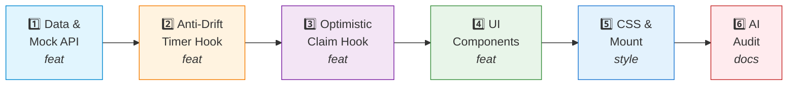

# WBS - Lab 3 Homework 3: KRAFTON x PUBG VN Arena

## Objective

Build an Airdrop Arena for the PUBG VN tournament, including an Anti-Drift Timer, Optimistic Claim with 409 Rollback, and a Team Leaderboard.

## Task Breakdown

| Task ID | Description | Commit Message | File(s) |
|---|---|---|---|
| HW3-00 | Init rules & WBS | `chore(hw3): init project rules and WBS` | `project-rules.md`, `TASK_DECOMPOSITION.md` |
| HW3-01 | Scaffold Vite React 19 | `chore(hw3): scaffold vite react 19 project` | `package.json`, `src/main.jsx` |
| HW3-02 | Data Contract & Mock API | `feat(hw3): add airdrop data and mock claim api` | `src/data/pubgArenaData.js` |
| HW3-03 | Anti-Drift Timer Hook | `feat(hw3): implement anti-drift airdrop timer hook` | `src/hooks/usePubgAirdropTimer.js` |
| HW3-04 | Optimistic Claim Hook | `feat(hw3): implement optimistic claim hook with 409 rollback` | `src/hooks/useAirdropClaim.js` |
| HW3-05 | Airdrop Arena Component (UI) | `feat(hw3): create airdrop arena component with timer and claim ui` | `src/components/AirdropArena.jsx` |
| HW3-06 | Leaderboard Component | `feat(hw3): build pubg vn leaderboard with derived sorting` | `src/components/Leaderboard.jsx` |
| HW3-07 | CSS Modules & Responsive | `style(hw3): add pubg themed layout and 375px responsive` | `src/components/Arena.module.css` |
| HW3-08 | Mount in App | `feat(hw3): mount arena in app` | `src/App.jsx` |
| HW3-09 | AI Failure Audit | `docs(audit): add ai failure mode audit report` | `AI_FAILURE_AUDIT.md` |

## Flow

## Acceptance Criteria

- [ ] Timer does not drift when switching tabs (uses `visibilitychange`).
- [ ] Claiming deducts stock immediately (Optimistic).
- [ ] `claimId` lock prevents double-claim (idempotent).
- [ ] Simulated 409 (Out of stock) error triggers automatic UI rollback of quantity.
- [ ] Leaderboard filter/sort uses Derived State (no `useEffect`).
- [ ] Zero `
` soup, Zero `var`.
